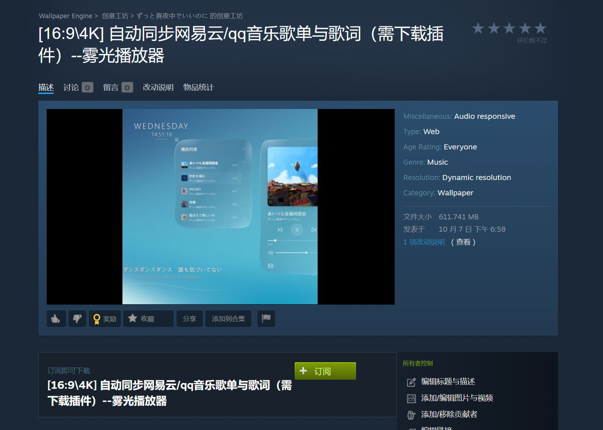
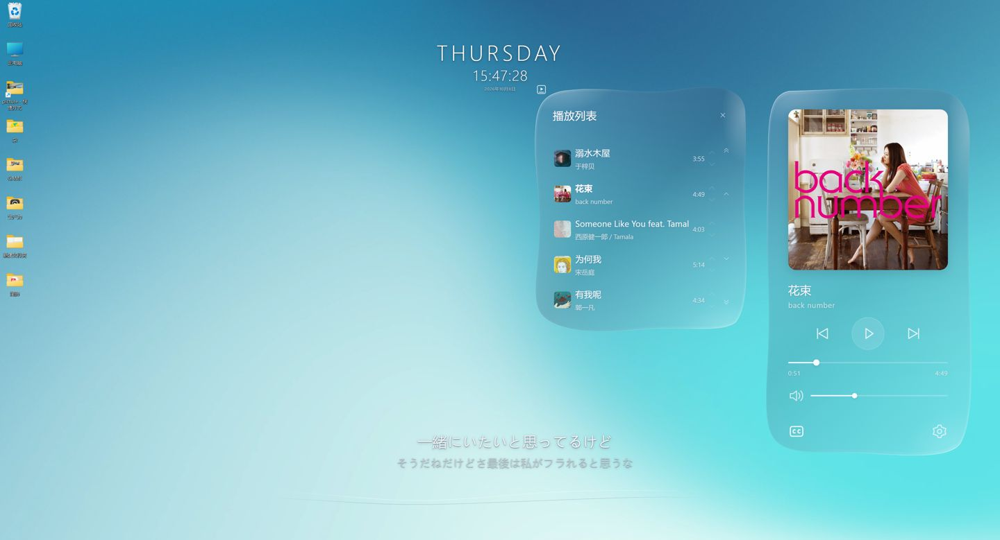
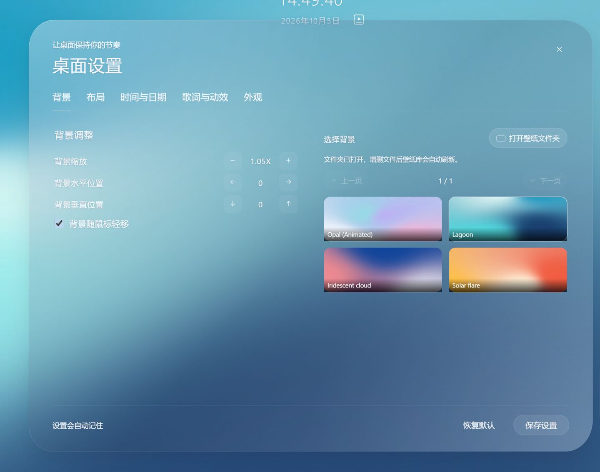

# 雾光 · 音乐桌面使用说明

[返回产品介绍](README.md)

## 1. 下载并应用壁纸

打开 [雾光的 Steam 创意工坊页面](https://steamcommunity.com/sharedfiles/filedetails/?id=3815178380)，登录 Steam 后点击 **订阅**。



等待下载完成，打开 Wallpaper Engine，在“已安装”列表找到“雾光播放器”并应用。你不需要自己导入 HTML，也不需要编辑代码。

订阅需要你已安装 Wallpaper Engine。此页面下载的是壁纸，音乐助手需要按下一步单独安装。

## 2. 安装音乐助手

回到本仓库首页，找到右侧 **Releases / 发布**，打开对应版本，在 **Assets / 附件** 中下载：

`Foglight-Music-Assistant-1.0.0-Setup.exe`

运行安装包，按提示完成安装并启动助手。无需额外安装 Python。

如果 GitHub 下载不便，也可以使用 [百度网盘备用下载](https://pan.baidu.com/s/1FXg3WWNoa7gJCXGrEHNEdQ?pwd=tjvm)，提取码 **tjvm**。下载文件名同样为 `Foglight-Music-Assistant-1.0.0-Setup.exe`。

助手启动后驻留在 Windows 系统托盘中，不会一直显示一个主窗口。若任务栏右下角看不到图标，展开隐藏图标区域检查。

右键助手托盘图标可以：

- 查看助手状态。
- 打开自定义壁纸文件夹。
- 启用 MP4 视频支持。
- 开启或关闭开机启动。
- 打开数据与日志目录。
- 退出助手。

第一次安装可先手动运行确认正常，再按需要开启开机启动。如果此前用过旧版联动脚本，请先退出旧脚本，避免与新版助手占用同一个本地端口。

## 3. 开始听歌

打开网易云音乐或 QQ 音乐桌面客户端，播放一首歌曲。助手会自动识别支持的客户端，壁纸显示对应歌曲信息。



网易云模式可同步当前本机播放队列；QQ 音乐目前同步当前歌曲，暂不支持完整队列。歌词需成功获取匹配内容，歌曲匹配错误、网络异常或无歌词歌曲可能无法显示。

播放面板提供播放 / 暂停、上一首、下一首和进度显示。播放控制与跳转取决于音乐客户端开放的能力。音量调节对应 **Windows 系统主音量**，会影响其他程序的声音。

点击专辑封面可展开当前播放列表，列表通过上下箭头翻页。时间附近的小播放器图标用于显示或隐藏播放面板。播放器底部的 **CC 图标**控制歌词显示，**齿轮图标**打开桌面设置。

如果两个音乐客户端都在运行，请先只在一个客户端播放，避免识别来源与你预期不一致。

## 4. 调整自己的桌面

点击播放器中的齿轮图标进入设置。



| 设置页 | 可以调整的内容 |
| --- | --- |
| 背景 | 选择背景、上下翻页、背景缩放、水平与垂直位置、背景随鼠标轻移 |
| 布局 | 播放界面位置与整体布局 |
| 时间与日期 | 时间和日期显示方式、位置等 |
| 歌词与动效 | 歌词大小、X / Y 位置、曲线与动效 |
| 外观 | 界面透明度、设置文字颜色等 |

设置会自动记住，也可以点击“保存设置”。如果浅色背景下看不清文字，先调整面板透明度，并在“外观”中选择更合适的设置文字颜色。恢复默认会重置相关设置，操作前请留意。

歌词曲线的音频响应需要 Wallpaper Engine 的“音频监听”开启。

## 5. 添加自己的壁纸

在“背景”设置页点击 **打开壁纸文件夹**，或者在助手托盘菜单选择 **打开自定义壁纸文件夹**。

打开的是当前 Windows 用户的自定义目录：

```text
%LOCALAPPDATA%\AhuiSaikou\Foglight\background
```

把自己的背景图片或视频复制到这里。助手运行时会扫描文件夹，新增或删除文件后，壁纸库会自动刷新；可使用上下翻页按钮查找。

**这个文件夹首次打开为空是正常的。** 内置背景随工坊壁纸提供，保存在壁纸项目中，并不放在自定义文件夹里。删除自定义文件只影响你添加的背景，不会删除内置背景。

### 添加 MP4 视频

1. 右键助手托盘图标，点击 **启用 MP4 视频支持（首次下载）**。
2. 确认后等待约 30 MB 视频工具下载完成。
3. 把 MP4 放进自定义壁纸文件夹。
4. 等待首次兼容缓存生成，再在壁纸设置中选择它。

视频越大，首次处理耗时可能越长；原文件不会被覆盖。内置视频和音乐同步无需下载这个工具。支持的图片（如 PNG / JPG）及可直接播放的 WebM 也可加入自定义目录。

## 常见问题

### 壁纸正常，但显示“未连接音乐客户端”

确认助手已启动且托盘图标存在，再到音乐客户端播放歌曲。只打开客户端但没有开始播放，可能没有可读取的媒体信息。仍然无结果时，检查客户端版本和助手日志。

### QQ 音乐没有显示完整歌单

当前版本只同步 QQ 音乐的当前歌曲，完整播放队列尚未支持。网易云同步的是本机当前播放队列，不是账号里的全部收藏歌单。

### 有歌曲，没有歌词或封面

等待网络请求完成，检查网络与歌曲匹配是否正常。部分歌曲没有可获取的歌词，当前版本不能保证每首歌曲都有封面或歌词。

### 进度条能显示，点击却不能跳转

跳转依赖音乐客户端的系统媒体接口。部分客户端或版本只提供进度，不开放跳转；这时请在音乐客户端内调整。

### 助手提示端口被占用

退出旧版联动脚本或另一份雾光助手，再重新启动。不要同时运行多个版本，不需要为此关闭音乐客户端。

### 新增 MP4 缩略图没有出现，或不能播放

先确认已启用 MP4 视频支持，再等待首次缓存生成。持续失败时，从助手托盘菜单打开数据与日志目录，查看 `assistant.log`；反馈时附文件格式、大小和错误信息。

### 更新或卸载

壁纸与助手分别更新：工坊负责壁纸，GitHub Releases 提供助手安装包。更新助手前先退出正在运行的助手，再安装新版本。卸载助手会保留用户自己的背景和缓存；卸载后壁纸的时钟与内置背景仍可使用，但联动功能不可用。

### 安装文件提示未知发布者

当前安装包没有代码签名。请从本仓库正式 Release 下载，并用同版本的 `SHA256SUMS.txt` 核对文件完整性，不要使用来源不明的转存安装包。

### 如何反馈问题

在本仓库 Issues 提交问题，注明 Windows 版本、音乐客户端及版本、助手版本、问题步骤，并附必要截图。日志可能包含歌曲名称和本机路径，发送前检查个人信息。

---

文档对应助手 **1.0.0**。截图用于说明实际界面，部分文字与背景可能随版本和个人设置变化。
